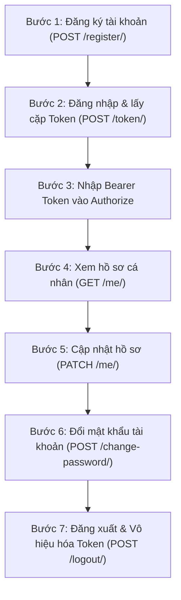

# Kịch Bản Demo Tương Tác API Authentication Trên Swagger UI

Tài liệu này cung cấp kịch bản demo thực tế từng bước (step-by-step) để báo cáo tiến độ, thuyết trình hoặc kiểm thử toàn bộ 7 API Authentication & Authorization của hệ thống SGOD trên giao diện **Swagger UI**.

---

## 1. Chuẩn Bị Trước Khi Demo

1. **Đảm bảo PostgreSQL 17 đang chạy** trên máy.
2. **Khởi động Backend Server**:
   ```powershell
   cd backend
   uv run python manage.py runserver 127.0.0.1:8000
   ```
3. **Mở trình duyệt truy cập Swagger UI**:
   👉 **[http://127.0.0.1:8000/api/v1/schema/swagger-ui/](http://127.0.0.1:8000/api/v1/schema/swagger-ui/)**

---

## 2. Kịch Bản 7 Bước Demo Chi Tiết



---

### Bước 1: Đăng ký tài khoản mới (`POST /api/v1/auth/register/`)
- **Mục đích**: Chứng minh khả năng đăng ký người dùng mới, tự động sinh khóa chính `UUIDv4` và mã hóa mật khẩu bảo mật (PBKDF2).
- **Thao tác**:
  1. Click mở mục **`POST /api/v1/auth/register/`**.
  2. Bấm nút **Try it out**.
  3. Dán payload JSON vào ô **Request body**:
     ```json
     {
       "email": "demo.user@example.com",
       "password": "DemoPassword123!",
       "first_name": "Nguyen",
       "last_name": "Van Demo"
     }
     ```
  4. Bấm **Execute**.
- **Kết quả kỳ vọng (HTTP 201 Created)**:
  ```json
  {
    "id": "e4a7c1b2-8f9d-4e12-b536-123456789abc",
    "email": "demo.user@example.com",
    "first_name": "Nguyen",
    "last_name": "Van Demo",
    "is_active": true,
    "date_joined": "2026-11-27T06:00:00Z",
    "message": "Đăng ký tài khoản thành công"
  }
  ```
  *(Điểm nhấn: `id` là chuỗi UUID chuẩn kiến trúc, không phải số nguyên tuần tự).*

---

### Bước 2: Đăng nhập & Nhận cặp JWT Token (`POST /api/v1/auth/token/`)
- **Mục đích**: Xác thực người dùng, trả về `access_token`, `refresh_token` và thông tin tài khoản.
- **Thao tác**:
  1. Click mở mục **`POST /api/v1/auth/token/`** -> Bấm **Try it out**.
  2. Dán payload JSON:
     ```json
     {
       "email": "demo.user@example.com",
       "password": "DemoPassword123!"
     }
     ```
  3. Bấm **Execute**.
- **Kết quả kỳ vọng (HTTP 200 OK)**:
  ```json
  {
    "access": "eyJhbGciOiJIUzI1NiIsInR5cCI6IkpXVCJ9...",
    "refresh": "eyJhbGciOiJIUzI1NiIsInR5cCI6IkpXVCJ9...",
    "user": {
      "id": "e4a7c1b2-8f9d-4e12-b536-123456789abc",
      "email": "demo.user@example.com",
      "first_name": "Nguyen",
      "last_name": "Van Demo"
    }
  }
  ```
- **Hành động quan trọng**:
  - Sao chép (Copy) chuỗi giá trị trong trường **`access`** để dùng cho Bước 3.
  - Sao chép chuỗi giá trị trong trường **`refresh`** để dùng cho Bước 7.

---

### Bước 3: Gắn Bearer Token vào Swagger UI
- **Mục đích**: Thiết lập xác thực Bearer Token toàn cục cho các API yêu cầu đăng nhập.
- **Thao tác**:
  1. Kéo lên góc trên cùng bên phải màn hình Swagger UI, nhấn nút **Authorize** (ổ khóa màu xanh lá).
  2. Trong ô **Value**, nhập chuỗi theo cú pháp:
     ```text
     Bearer <chuỗi_access_copy_từ_bước_2>
     ```
     *(Ví dụ: `Bearer eyJhbGciOiJIUzI1Ni...`)*
  3. Bấm nút **Authorize** -> Bấm **Close**.
  *(Lúc này tất cả các biểu tượng ổ khóa bên cạnh các API bảo mật sẽ chuyển sang trạng thái đã khóa).*

---

### Bước 4: Xem hồ sơ cá nhân (`GET /api/v1/auth/me/`)
- **Mục đích**: Xác minh middleware giải mã Bearer Token và trích xuất đúng tài khoản người dùng hiện tại từ PostgreSQL.
- **Thao tác**:
  1. Click mở mục **`GET /api/v1/auth/me/`** -> Bấm **Try it out**.
  2. Bấm **Execute** (không cần nhập tham số).
- **Kết quả kỳ vọng (HTTP 200 OK)**:
  ```json
  {
    "id": "e4a7c1b2-8f9d-4e12-b536-123456789abc",
    "email": "demo.user@example.com",
    "first_name": "Nguyen",
    "last_name": "Van Demo",
    "is_active": true,
    "date_joined": "2026-11-27T06:00:00Z"
  }
  ```

---

### Bước 5: Cập nhật hồ sơ cá nhân (`PATCH /api/v1/auth/me/`)
- **Mục đích**: Cập nhật thông tin từng phần (Partial Update) cho `first_name` và `last_name`.
- **Thao tác**:
  1. Click mở mục **`PATCH /api/v1/auth/me/`** -> Bấm **Try it out**.
  2. Dán payload JSON:
     ```json
     {
       "first_name": "Nguyen VIP",
       "last_name": "Van Demo Edited"
     }
     ```
  3. Bấm **Execute**.
- **Kết quả kỳ vọng (HTTP 200 OK)**:
  ```json
  {
    "id": "e4a7c1b2-8f9d-4e12-b536-123456789abc",
    "email": "demo.user@example.com",
    "first_name": "Nguyen VIP",
    "last_name": "Van Demo Edited",
    "is_active": true,
    "date_joined": "2026-11-27T06:00:00Z"
  }
  ```

---

### Bước 6: Đổi mật khẩu tài khoản (`POST /api/v1/auth/change-password/`)
- **Mục đích**: Kiểm tra xác thực mật khẩu cũ và đổi sang mật khẩu mới.
- **Thao tác**:
  1. Click mở mục **`POST /api/v1/auth/change-password/`** -> Bấm **Try it out**.
  2. Dán payload JSON:
     ```json
     {
       "old_password": "DemoPassword123!",
       "new_password": "BrandNewPassword456!"
     }
     ```
  3. Bấm **Execute**.
- **Kết quả kỳ vọng (HTTP 200 OK)**:
  ```json
  {
    "detail": "Đổi mật khẩu thành công."
  }
  ```
  *(Có thể demo nhanh: mở lại `POST /api/v1/auth/token/` đăng nhập với mật khẩu cũ sẽ báo lỗi 401, đăng nhập với mật khẩu mới sẽ thành công 200).*

---

### Bước 7: Đăng xuất & Vô hiệu hóa Token (`POST /api/v1/auth/logout/`)
- **Mục đích**: Đưa Refresh Token vào danh sách đen (`Blacklist`), chống tấn công phát lại (Replay Attack).
- **Thao tác**:
  1. Click mở mục **`POST /api/v1/auth/logout/`** -> Bấm **Try it out**.
  2. Dán chuỗi `refresh` token đã lưu ở Bước 2:
     ```json
     {
       "refresh": "<chuỗi_refresh_copy_từ_bước_2>"
     }
     ```
  3. Bấm **Execute**.
- **Kết quả kỳ vọng (HTTP 200 OK)**:
  ```json
  {
    "detail": "Đăng xuất thành công."
  }
  ```

- **Chứng minh Token đã bị vô hiệu hóa (Bảo mật nâng cao)**:
  1. Mở endpoint **`POST /api/v1/auth/token/refresh/`** -> Bấm **Try it out**.
  2. Dán lại chính chuỗi `refresh` token vừa đăng xuất ở trên -> Bấm **Execute**.
  3. **Kết quả**: Báo lỗi `HTTP 401 Unauthorized`:
     ```json
     {
       "detail": "Token is blacklisted",
       "code": "token_not_valid"
     }
     ```
     *(Chứng minh hệ thống bảo mật chặt chẽ, token đã đăng xuất không bao giờ được phép tái sử dụng).*

---

## 3. Tổng Hợp Bảng Mã Lỗi Dùng Cho Demo Kịch Bản Ngoại Lệ (Edge Cases)

| Kịch Bản Thử Nghiệm | Endpoint | Thao Tác | Mã HTTP | Thông Báo |
| :--- | :--- | :--- | :--- | :--- |
| **Đăng ký trùng email** | `POST /register/` | Đăng ký lại email `demo.user@example.com` | `400 Bad Request` | `{"email": ["Email này đã được sử dụng trên hệ thống."]}` |
| **Sai mật khẩu đăng nhập** | `POST /token/` | Nhập sai mật khẩu | `401 Unauthorized` | `{"detail": "No active account found with the given credentials"}` |
| **Truy cập không có Token** | `GET /me/` | Nhấn Authorize -> Logout -> Gọi GET /me/ | `401 Unauthorized` | `{"detail": "Authentication credentials were not provided."}` |
| **Sai mật khẩu cũ** | `POST /change-password/` | Nhập sai `old_password` | `400 Bad Request` | `{"old_password": ["Mật khẩu cũ không chính xác."]}` |
| **Dùng token đã blacklist** | `POST /token/refresh/` | Gửi refresh token đã logout | `401 Unauthorized` | `{"detail": "Token is blacklisted"}` |
