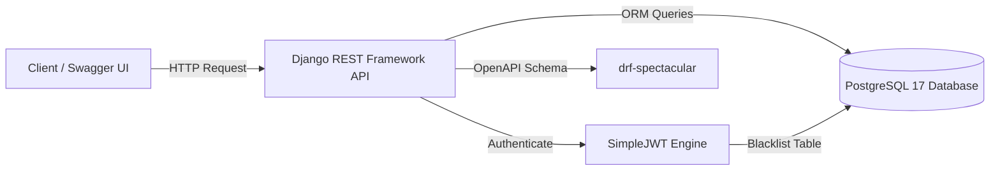

# Kế Hoạch Triển Khai Chi Tiết: Module Authentication & Authorization (Backend & Swagger UI)

Tài liệu này đóng vai trò là bản checklist kỹ thuật chi tiết phục vụ việc triển khai phân hệ Xác thực & Phân quyền (App `accounts`) cho nền tảng SGOD. Mọi công việc được chia thành các Subtask tuần tự với các hộp kiểm (checkboxes `[ ]`) để dễ dàng theo dõi tiến độ và nghiệm thu.

---

## 1. Tổng Quan Kiến Trúc & Các Quyết Định Kỹ Thuật

- **Môi trường Database**: PostgreSQL 17 (qua `compose.yaml` hoặc service cục bộ).
- **Domain Identity**: `accounts.User` kế thừa `AbstractUser`, sử dụng `id UUIDv4` làm Primary Key, đăng nhập bằng `email` (`USERNAME_FIELD = "email"`, `username = None`). Giữ nguyên các trường phân quyền Django (`groups`, `user_permissions`, `is_superuser`, `is_staff`).
- **Cơ chế Token**: `djangorestframework-simplejwt` với cấu hình Access Token 15 phút, Refresh Token 7 ngày, bật Rotation & Blacklist.
- **Tài liệu hóa API**: `drf-spectacular` sinh chuẩn OpenAPI 3.0, hỗ trợ kiểm thử tương tác qua **Swagger UI** (`/api/v1/schema/swagger-ui/`) với nút **Authorize (Bearer Token)**.
- **Kiểm thử tự động**: `pytest-django` kết nối trực tiếp PostgreSQL test database.



---

## 2. Danh Sách Subtasks & Checklists Tiến Độ

### [ ] Subtask 1: Foundation, Dependencies & Cấu Hình Core (`settings.py`)
Mục tiêu: Cài đặt các thư viện cần thiết, loại bỏ cấu hình SQLite3 ghi đè và thiết lập cấu hình chuẩn cho JWT và OpenAPI Schema.

- [ ] **1.1. Cài đặt các package qua `uv`**:
  ```powershell
  cd backend
  uv add djangorestframework-simplejwt drf-spectacular
  ```
- [ ] **1.2. Dọn dẹp cấu hình ghi đè trong `backend/config/settings.py`**:
  - [ ] Xóa bỏ khối ghi đè `ALLOWED_HOSTS = []` ở dòng 48 (để dùng biến `ALLOWED_HOSTS` đọc từ `.env`).
  - [ ] Xóa bỏ khối ghi đè `DATABASES` SQLite3 ở dòng 110–115 (để dùng `DATABASES` đọc từ `DATABASE_URL` ở dòng 34–36).
- [ ] **1.3. Cấu hình `INSTALLED_APPS` trong `settings.py`**:
  - [ ] Thêm `"rest_framework_simplejwt.token_blacklist"`
  - [ ] Thêm `"drf_spectacular"`
- [ ] **1.4. Thiết lập cấu hình `REST_FRAMEWORK`**:
  ```python
  REST_FRAMEWORK = {
      "DEFAULT_AUTHENTICATION_CLASSES": (
          "rest_framework_simplejwt.authentication.JWTAuthentication",
      ),
      "DEFAULT_PERMISSION_CLASSES": (
          "rest_framework.permissions.IsAuthenticated",
      ),
      "DEFAULT_SCHEMA_CLASS": "drf_spectacular.openapi.AutoSchema",
  }
  ```
- [ ] **1.5. Thiết lập cấu hình `SIMPLE_JWT`**:
  ```python
  from datetime import timedelta

  SIMPLE_JWT = {
      "ACCESS_TOKEN_LIFETIME": timedelta(minutes=15),
      "REFRESH_TOKEN_LIFETIME": timedelta(days=7),
      "ROTATE_REFRESH_TOKENS": True,
      "BLACKLIST_AFTER_ROTATION": True,
      "UPDATE_LAST_LOGIN": True,
      "ALGORITHM": "HS256",
      "SIGNING_KEY": SECRET_KEY,
      "AUTH_HEADER_TYPES": ("Bearer",),
      "USER_ID_FIELD": "id",
      "USER_ID_CLAIM": "user_id",
  }
  ```
- [ ] **1.6. Thiết lập cấu hình `SPECTACULAR_SETTINGS`**:
  ```python
  SPECTACULAR_SETTINGS = {
      "TITLE": "SGOD Platform API",
      "DESCRIPTION": "OCR & Face Annotation Platform API Documentation",
      "VERSION": "v1.0.0",
      "SERVE_INCLUDE_SCHEMA": False,
      "COMPONENT_SPLIT_REQUEST": True,
  }
  ```
- [ ] **1.7. Đồng bộ `.env.example`**:
  - [ ] Chỉnh sửa mật khẩu `POSTGRES_PASSWORD=1234` khớp hoàn toàn với `DATABASE_URL`.
- [ ] **1.8. Nghiệm thu Subtask 1**:
  - [ ] Chạy lệnh `uv run python manage.py check` không phát sinh lỗi cấu hình.

---

### [ ] Subtask 2: Tái Cấu Trúc Model `User` & Khởi Tạo Migration PostgreSQL
Mục tiêu: Đảm bảo model `User` sử dụng khóa chính UUIDv4 chuẩn kiến trúc hệ thống và áp dụng sạch sẽ vào PostgreSQL.

- [ ] **2.1. Cập nhật `backend/accounts/models.py`**:
  - [ ] Import thư viện `uuid`.
  - [ ] Khai báo trường khóa chính `id = models.UUIDField(primary_key=True, default=uuid.uuid4, editable=False)`.
  - [ ] Đảm bảo `UserManager` xử lý chính xác `create_user` và `create_superuser` với email.
  - [ ] Giữ kế thừa `AbstractUser` để duy trì `groups`, `user_permissions`, `is_superuser`, `is_staff`.
- [ ] **2.2. Dọn dẹp migration cũ và file SQLite tồn dư**:
  - [ ] Xóa file migration ban đầu `backend/accounts/migrations/0001_initial.py` (do đang dùng `BigAutoField`).
  - [ ] Xóa file `backend/db.sqlite3` cũ (nếu có).
- [ ] **2.3. Khởi tạo Migration mới**:
  ```powershell
  uv run python manage.py makemigrations accounts
  ```
- [ ] **2.4. Thực thi Migration lên PostgreSQL**:
  ```powershell
  uv run python manage.py migrate
  ```
- [ ] **2.5. Nghiệm thu Subtask 2**:
  - [ ] Chạy `uv run python manage.py showmigrations` xác nhận tất cả migrations (`accounts`, `auth`, `token_blacklist`) đã có dấu tích `[X]`.

---

### [ ] Subtask 3: Triển Khai Serializers & Business Logic
Mục tiêu: Xây dựng các Serializers kiểm tra dữ liệu đầu vào, mã hóa mật khẩu và cấu trúc payload phản hồi.

- [ ] **3.1. Tạo mới file `backend/accounts/serializers.py`**:
- [ ] **3.2. Triển khai `RegisterSerializer`**:
  - [ ] Các trường: `email`, `password`, `first_name`, `last_name`.
  - [ ] Validate email không trùng lặp (`User.objects.filter(email=value).exists()`).
  - [ ] Băm mật khẩu thông qua phương thức `User.objects.create_user(...)`.
  - [ ] Thiết lập `password` là `write_only=True`.
- [ ] **3.3. Triển khai `CustomTokenObtainPairSerializer`**:
  - [ ] Kế thừa `TokenObtainPairSerializer`.
  - [ ] Bổ sung trường thông tin `user` vào phản hồi:
    ```python
    data["user"] = {
        "id": str(self.user.id),
        "email": self.user.email,
        "first_name": self.user.first_name,
        "last_name": self.user.last_name,
    }
    ```
- [ ] **3.4. Triển khai `UserSerializer` & `UserUpdateSerializer`**:
  - [ ] `UserSerializer` (read-only): `id`, `email`, `first_name`, `last_name`, `is_active`, `date_joined`.
  - [ ] `UserUpdateSerializer` (update): Cho phép chỉnh sửa `first_name`, `last_name`.
- [ ] **3.5. Triển khai `ChangePasswordSerializer`**:
  - [ ] Nhận `old_password` và `new_password`.
  - [ ] Kiểm tra mật khẩu cũ qua `user.check_password(old_password)`.
  - [ ] Cập nhật mật khẩu mới qua `user.set_password(new_password)`.
- [ ] **3.6. Triển khai `LogoutSerializer`**:
  - [ ] Nhận trường `refresh` token.
  - [ ] Validate chuỗi token hợp lệ và gọi `RefreshToken(token).blacklist()`.
- [ ] **3.7. Nghiệm thu Subtask 3**:
  - [ ] Khởi động `uv run python manage.py shell` và import kiểm tra cú pháp serializers thành công.

---

### [ ] Subtask 4: Xây Dựng Views, Routing & Gắn OpenAPI Swagger Decorators
Mục tiêu: Hiện thực hóa 7 endpoints API và cấu hình giao diện Swagger UI / ReDoc.

- [ ] **4.1. Triển khai `backend/accounts/views.py`**:
  - [ ] `RegisterView` (`generics.CreateAPIView` hoặc `APIView`, `permission_classes=[AllowAny]`).
  - [ ] `CustomTokenObtainPairView` (`TokenObtainPairView`, `permission_classes=[AllowAny]`).
  - [ ] `TokenRefreshView` (`TokenRefreshView`, `permission_classes=[AllowAny]`).
  - [ ] `LogoutView` (`APIView`, `permission_classes=[IsAuthenticated]`).
  - [ ] `UserMeView` (`generics.RetrieveUpdateAPIView`, `permission_classes=[IsAuthenticated]`).
  - [ ] `ChangePasswordView` (`APIView`, `permission_classes=[IsAuthenticated]`).
- [ ] **4.2. Gắn OpenAPI Schema Decorators (`@extend_schema`)**:
  - [ ] Gắn tags `["Authentication"]` cho tất cả endpoints.
  - [ ] Định nghĩa rõ request body và responses (200, 201, 400, 401) cho từng action.
- [ ] **4.3. Tạo file routing `backend/accounts/urls.py`**:
  ```python
  from django.urls import path
  from rest_framework_simplejwt.views import TokenRefreshView
  from .views import (
      RegisterView, CustomTokenObtainPairView, LogoutView,
      UserMeView, ChangePasswordView
  )

  urlpatterns = [
      path("register/", RegisterView.as_view(), name="register"),
      path("token/", CustomTokenObtainPairView.as_view(), name="token_obtain_pair"),
      path("token/refresh/", TokenRefreshView.as_view(), name="token_refresh"),
      path("logout/", LogoutView.as_view(), name="logout"),
      path("me/", UserMeView.as_view(), name="user_me"),
      path("change-password/", ChangePasswordView.as_view(), name="change_password"),
  ]
  ```
- [ ] **4.4. Cập nhật `backend/config/urls.py`**:
  - [ ] Nhúng `path("api/v1/auth/", include("accounts.urls"))`.
  - [ ] Khai báo Swagger UI & ReDoc:
    ```python
    from drf_spectacular.views import SpectacularAPIView, SpectacularSwaggerView, SpectacularRedocView

    urlpatterns += [
        path("api/v1/schema/", SpectacularAPIView.as_view(), name="schema"),
        path("api/v1/schema/swagger-ui/", SpectacularSwaggerView.as_view(url_name="schema"), name="swagger-ui"),
        path("api/v1/schema/redoc/", SpectacularRedocView.as_view(url_name="schema"), name="redoc"),
    ]
    ```
- [ ] **4.5. Nghiệm thu Subtask 4**:
  - [ ] Chạy lệnh `uv run python manage.py spectacular --file schema.yaml` để xác nhận schema sinh chuẩn xác không có lỗi warning.

---

### [ ] Subtask 5: Automated Testing Suite & Nghiệm Thu Swagger UI
Mục tiêu: Đảm bảo toàn bộ 7 API endpoints hoạt động chính xác với tỷ lệ test pass 100% và kiểm thử tương tác trực tiếp trên Swagger UI.

- [ ] **5.1. Thiết lập môi trường test `backend/pytest.ini`**:
  ```ini
  [pytest]
  DJANGO_SETTINGS_MODULE = config.settings
  python_files = tests.py test_*.py *_tests.py
  ```
- [ ] **5.2. Viết Test Suite `backend/accounts/tests/test_auth_api.py`**:
  - [ ] Test FR-01: Đăng ký thành công (`201 Created`, ID là chuỗi UUID, mật khẩu được mã hóa PBKDF2).
  - [ ] Test FR-01: Báo lỗi khi đăng ký trùng email (`400 Bad Request`).
  - [ ] Test FR-02: Đăng nhập thành công trả về cặp JWT Token + thông tin User (`200 OK`).
  - [ ] Test FR-02: Đăng nhập thất bại khi sai mật khẩu (`401 Unauthorized`).
  - [ ] Test FR-04: Làm mới Token thành công với Refresh Token hợp lệ (`200 OK`).
  - [ ] Test FR-07: Lấy thông tin cá nhân `GET /api/v1/auth/me/` có Header Bearer Token (`200 OK`).
  - [ ] Test FR-05 & FR-06: Từ chối truy cập `GET /api/v1/auth/me/` khi không có Bearer Token (`401 Unauthorized`).
  - [ ] Test FR-08: Cập nhật họ tên `PATCH /api/v1/auth/me/` thành công (`200 OK`).
  - [ ] Test FR-09: Đổi mật khẩu thành công `POST /api/v1/auth/change-password/` (`200 OK`).
  - [ ] Test FR-09: Báo lỗi khi nhập sai mật khẩu cũ (`400 Bad Request`).
  - [ ] Test FR-03: Đăng xuất và đưa Refresh Token vào Blacklist (`200 OK`).
  - [ ] Test FR-03: Thử sử dụng lại Refresh Token đã bị Blacklist để làm mới và xác nhận bị từ chối (`401 Unauthorized`).
- [ ] **5.3. Thực thi automated test**:
  ```powershell
  uv run pytest
  ```
- [ ] **5.4. Nghiệm thu trực tiếp trên Swagger UI**:
  - [ ] Khởi động server: `uv run python manage.py runserver 127.0.0.1:8000`
  - [ ] Truy cập trình duyệt: `http://127.0.0.1:8000/api/v1/schema/swagger-ui/`
  - [ ] Thực hiện kịch bản "Try it out" đăng ký tài khoản mới `/api/v1/auth/register/`.
  - [ ] Đăng nhập tại `/api/v1/auth/token/` để lấy `access_token`.
  - [ ] Bấm nút **Authorize** ở góc trên Swagger UI, dán chuỗi Bearer token.
  - [ ] Gọi thử `GET /api/v1/auth/me/`, `PATCH /api/v1/auth/me/`, `POST /api/v1/auth/change-password/`, `POST /api/v1/auth/logout/`.

---

## 3. Ma Trận API Nghiệm Thu

| Endpoint | Method | Permission | Payload Mẫu | Mã HTTP Kỳ Vọng |
| :--- | :--- | :--- | :--- | :--- |
| `/api/v1/auth/register/` | `POST` | `AllowAny` | `{"email": "...", "password": "...", "first_name": "...", "last_name": "..."}` | `201 Created` / `400 Bad Request` |
| `/api/v1/auth/token/` | `POST` | `AllowAny` | `{"email": "...", "password": "..."}` | `200 OK` (trả về access, refresh, user) / `401 Unauthorized` |
| `/api/v1/auth/token/refresh/` | `POST` | `AllowAny` | `{"refresh": "..."}` | `200 OK` (trả về access mới) / `401 Unauthorized` |
| `/api/v1/auth/logout/` | `POST` | `IsAuthenticated` | `{"refresh": "..."}` | `200 OK` / `400 Bad Request` |
| `/api/v1/auth/me/` | `GET` | `IsAuthenticated` | None (Bearer Token Header) | `200 OK` / `401 Unauthorized` |
| `/api/v1/auth/me/` | `PATCH` | `IsAuthenticated` | `{"first_name": "...", "last_name": "..."}` | `200 OK` / `400 Bad Request` |
| `/api/v1/auth/change-password/` | `POST` | `IsAuthenticated` | `{"old_password": "...", "new_password": "..."}` | `200 OK` / `400 Bad Request` |
